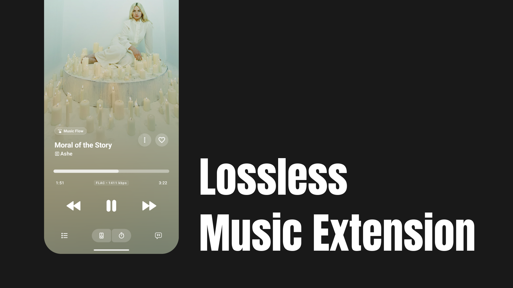

<p align="center">
  
</p>

A self-hosted lossless music addon for Echo Music — powered by six upstream providers, deployed in one click.

---

## Getting Started

### Requirements

- A [Vercel account](https://vercel.com/signup) _(free tier works)_
- A [GitHub account](https://github.com/signup)

---

## Step 1 — Deploy to Vercel

[](https://vercel.com/new/clone?repository-url=https://github.com/EchoMusicApp/lossless-extension&project-name=lossless-extension&repository-name=lossless-extension&env=QOBUZ_ID_SECRET&envDescription=A%20long%20random%20secret%20used%20to%20sign%20track%20IDs.%20Generate%20one%20with%20openssl%20rand%20-hex%2032&envLink=https://github.com/EchoMusicApp/lossless-extension%23provider-configuration)

1. Click the **Deploy with Vercel** button above.
2. Sign in to Vercel and connect your GitHub account when prompted.
3. Vercel will fork this repository into your account automatically.
4. Set the required environment variable when asked:

   | Variable          | Required | Description                                                                            |
   | :---------------- | :------: | :------------------------------------------------------------------------------------- |
   | `QOBUZ_ID_SECRET` |    ✅    | A long random secret used to sign track IDs. Generate one with `openssl rand -hex 32`. |

   > All other variables are optional — defaults are built in. See [Provider Configuration](#provider-configuration) for the full list.

5. Click **Deploy** and wait for the build to finish.

---

## Step 2 — Get Your Server URL

1. Open your project in the [Vercel Dashboard](https://vercel.com/dashboard).
2. Copy the production URL from the **Deployments** tab. It will look like:

   ```
   https://lossless-extension.vercel.app
   ```

> **Note:** Always use the root URL. Do not append `/search`, `/stream`, or anything else.

---

## Step 3 — Add to Echo Music

1. Open **Echo Music**.
2. Go to **Settings → Sources → Add an Addon**.
3. Enter a name (e.g. `Lossless`) and paste your Vercel URL as the **Server URL**.
4. Save and enable the addon.

That's it — search for any track and enjoy audio at up to **lossless FLAC quality**. Tracks without a lossless stream automatically fall back to the best available quality.

---

## Provider Configuration

The addon runs six upstream backends in parallel and uses whichever responds first. Only `QOBUZ_ID_SECRET` is required; everything else has a working default.

```dotenv
# Required
QOBUZ_ID_SECRET=           # generate with: openssl rand -hex 32

# Optional — defaults shown
QOBUZ_PROVIDER=multi       # multi | qobuzdl | http | stub
QOBUZ_UPSTREAM_BASE_URL=https://qobuz-dll.foreyou.workers.dev
LASTBABE_BASE_URL=https://lastbabe.velixir.run
MONOCHROME_BASE_URL=https://tracks.monochrome.st
DEEZER_BASE_URL=https://dzr.tabs-vs-spaces.wtf
ELJOHNZC_BASE_URL=https://eljohnzc-addon.de.deplexo.com/4433c7caff7fd070309e
INSTABLE_BASE_URL=https://instable.arcod.xyz
```

### Available Providers

Each provider is also accessible via its own isolated route prefix — useful for testing a specific source directly.

|  Prefix  | Provider                            | Quality               |
| :------: | :---------------------------------- | :-------------------- |
| _(root)_ | **Multi** — races all six providers | FLAC / best available |
|   `/a`   | Qobuz-DL                            | Lossless              |
|   `/b`   | LastBabe                            | Lossless              |
|   `/c`   | Monochrome                          | FLAC                  |
|   `/d`   | Deezer                              | High / Low            |
|   `/e`   | Eljohnzc                            | Lossless              |
|   `/f`   | Instable                            | Lossless              |

Every prefix exposes the same three endpoints: `/manifest.json`, `/search`, and `/stream/:id`.

---

## Local Development

Node.js 20 or later is required.

**Install and run:**

```bash
npm install
npm run dev
```

**Build and test:**

```bash
npm run build
npm test
```

**Try the API locally:**

```bash
# Manifest
curl http://localhost:3000/manifest.json

# Search
curl 'http://localhost:3000/search?q=kind+of+blue&quality=LOSSLESS&atmos=auto'

# Stream info
curl -i 'http://localhost:3000/stream/qobuz_abc123?quality=LOSSLESS&atmos=auto'
```

---

## License

Licensed under [GPL-3.0](LICENSE). This is an unofficial extension; upstream provider usage limits apply.

---

## Legal & Responsible Use

### No music is stored

This server stores nothing. When a user searches or presses play, the addon fetches a publicly accessible stream URL from a third-party upstream provider in real time and passes it directly to the client. No audio files are cached, downloaded, or redistributed by this software.

### Open source

The full source code is available on [GitHub](https://github.com/EchoMusicApp/lossless-extension) under the **GPL-3.0** license. You are free to inspect, fork, and self-host it under those terms.

### Your responsibility as the host

> [!CAUTION]
> By deploying and hosting this server, **you** — not the software author — are solely responsible for ensuring its use complies with all applicable laws, regulations, and third-party terms of service in your jurisdiction. This includes but is not limited to copyright law and the terms of service of any upstream music providers whose APIs this addon may interact with.
>
> The author of this software accepts **no liability** for any misuse, copyright infringement, or other unlawful conduct arising from your deployment.

### Disclaimer

This is an unofficial, community-built addon. It is not affiliated with, endorsed by, or connected to Qobuz, Deezer, JioSaavn, or any other music service. All trademarks and service marks belong to their respective owners. Upstream provider availability may change at any time without notice.
